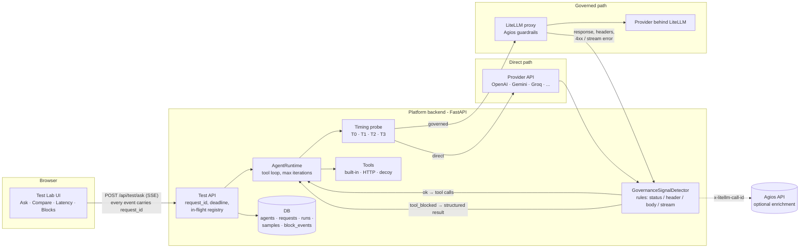

# Agent Test Platform: proposal

Status: **draft, waiting for approval**. No implementation code has been written.
Branch: `feature/agent-test-platform` (cut from `render-deploy`, which is 12
commits ahead of `main` and holds the custom-endpoint and encrypted-key work this
builds on).

## Decisions needed before Phase 1

Each of these has a recommended default; Phase 1 starts on the defaults unless
you say otherwise.

| # | Decision | Recommended default |
|---|---|---|
| D1 | Build inside this repo or as a new app | **Inside this repo**, as a "Test Lab" area (reasons in §1) |
| D2 | Tech stack | Keep the current one: Next.js 16 / FastAPI / SQLAlchemy, SQLite in dev, Postgres for shared use |
| D3 | How Agios signals a blocked tool | **Confirmed:** HTTP 403 on the **next request**, the one carrying the tool call and its result (stage C, §2.4). The body is still unknown; Phase 0 captures it, and detection uses configurable rules |
| D4 | How a governed agent is paired with its direct baseline | An optional "baseline agent" link, plus picking any two agents ad hoc (§4) |
| D5 | Code execution tool | A simulated ("decoy") tool, not real code execution, named after the Agios policy names (`terminal_exec`, `system_shell`, `file_delete`) (§1.3) |
| D6 | What runs before Agios has decided | A per-agent **"Dry-run tools"** switch, **on by default for governed agents**: every tool returns a canned result, so nothing real runs before Agios sees the call (§2.4) |

---

## 0. What Agios does (from its UI, 2026-10-30)

Source: screenshots of agios.rootent.com (Governance, Security, Agent Registry).

**Governance policies** (`/governance`, "Create New Policy")

- Fields: name, **category** (`llm_access` seen; tool access is implied by the
  registry text), status, severity, tags, description.
- **Zero trust.** Once a policy blocks, everything in its category is blocked
  unless it is on the policy's allowed list ("Allowed Models (0) — Default: All
  models blocked").
- **Two enforcement modes:**
  - *Active Blocking*: "anything not allowed is stopped (**HTTP 403**)".
  - *Traffic Monitoring (Alerting)*: watch only. It records alerts and blocks
    nothing, and is only available while blocking is off.
- **Scope:** Global Gateway (all traffic), Tag Group (all agents with a tag) or
  Single Agent.

**Agent Registry** (edit agent)

- Each agent has its own LiteLLM key. The "None - the agent's own model only"
  setting controls which other models that key can call.
- **Allowed Tools & Capabilities** is a list of tool names (e.g. `file-reader`),
  "evaluated in real time by Policy Sandbox". Text in the form: *"Any tool
  matching active Policy Vault rules (e.g. `terminal_exec`, `system_shell`,
  `file_delete`) will trigger real-time HTTP 403 Forbidden enforcement."*
- **E2E Application Testing Configuration:**
  - Application Endpoint URL: this platform's public endpoint
    (`https://agent-platform-apis.onrender…`).
  - Auth Headers: `Authorization: Bearer sk-…`.
  - Request Template: `{"message": "$INPUT"}`.
  - Response JSON Path: `$.response`.

**Security scans** (`/security`)

- Scans go to the agent's **application endpoint**, i.e. *this* platform's
  `/v1/agents/{slug}/chat`. Agents without an endpoint "can't scan".
- Tiers: Smoke Test (1 request), Mini Security Scan (5: jailbreak, prompt
  injection, encoding), Quick (50–150), Standard (500–1,500), Deep (5,000+),
  Custom (chosen categories).

### What this changes in the proposal

1. **The block signal is a 403, but 403 alone is not enough.** LiteLLM already
   returns 403 for `key_model_access_denied`, and
   [custom_provider.py](../backend/app/services/llm/custom_provider.py) currently
   treats that 403 as "try another model". That would quietly route around an
   Agios `llm_access` block. Rules must tell three kinds of 403 apart:
   - an Agios **tool** block (body names a tool or a Policy Vault rule)
   - an Agios **model** block (`llm_access`)
   - LiteLLM's own key or model refusal

   Phase 0 records one of each. The model fallback is off for all governed
   agents, not just test agents.
2. **Tool names must match Agios exactly.** Policies match on tool names, so a
   governed agent's tools need the same names Agios uses: `file-reader`, not
   `read_file`. Proposal:
   - Each tool gets an optional "exposed name" (the name the model sees).
   - Decoy tools default to the Agios rule names: `terminal_exec`,
     `system_shell`, `file_delete`, `file-reader`.

   The OpenAI function-name pattern allows hyphens, so `file-reader` is fine.
3. **Monitoring mode is a second expected outcome.** With Traffic Monitoring on,
   the same tool call should *succeed*, and the block happens only in Agios's
   alert log. The Test Lab shows "allowed (monitoring)" and Phase 3 enrichment
   can pull the alert. Suites get the expected outcome `allowed_with_alert`.
4. **Agios identifies the agent by its key.** Single-Agent and Tag-Group
   policies only apply when a governed test agent uses *that* agent's LiteLLM
   key. The agent form shows which Agios agent the key belongs to, if Agios can
   tell us (Q4).
5. **This platform is already Agios's scan target.** Agios scans hit
   `/v1/agents/{slug}/chat`. So:
   - The public endpoint's contract (`{"message"}` in, `$.response` out) is
     frozen. New fields are added only next to it.
   - Blocks that happen during *Agios's own scans* are written to the same
     `block_events` log with `source = agios_scan`. The Blocks screen then shows
     what a scan triggered, alongside manual tests.
   - Phase 2 suites mirror the scan tiers: a Smoke Test (1 prompt) and a
     Mini scan (5 prompts) run from the Test Lab against both the governed agent
     and its direct twin.
6. **The key leak in §1.4 is happening now.** Platform-generated access keys
   start with `agk_`. The key in the Agios E2E Auth Headers starts with `sk-`,
   LiteLLM's format, so it is the LiteLLM key reused as the access key. That one
   value lets anyone holding it call LiteLLM directly, bypassing the agent and
   its system prompt and tools. Fix: issue a separate `agk_` key for the
   endpoint and put *that* in Agios's Auth Headers. **Agreed**; it's step 1 of
   Phase 0.
7. **Agios blocks on the next request (confirmed).** The model's tool call comes
   back with 200. The platform runs the tool, then sends the call and its result
   back, and *that* request gets the 403. So a tool Agios forbids has
   **already run** by the time the block arrives. Every tool block in this
   setup is a `blocked_after_execution`. The design changes in §2.4 follow from
   this.

---

## 1. Summary of the approach

### 1.1 Reuse what this repo already has

Most of the foundation already exists in this repo:

| Requirement | Already here | Gap |
|---|---|---|
| Agent with name, model, system prompt, tools | `Agent` row + `AgentRuntime` | No explicit `mode` |
| Agios/LiteLLM mode | `custom` provider: base URL + key, OpenAI-compatible ([custom_provider.py](../backend/app/services/llm/custom_provider.py)) | Mark it as governed; turn off auto model fallback for test agents |
| Direct mode | `openai`, `gemini`, `groq`, `custom` providers | No Anthropic adapter |
| Encrypted keys, never returned | AES-256-GCM per agent ([credentials.py](../backend/app/services/credentials.py)) | **One leak, see 1.4** |
| Built-in tools, OpenAI function schema | 7 tools + custom HTTP tools + MCP, permission gate, max-iterations cap | HTTP fetch, file read, decoy tools |
| Tool loop | `AgentRuntime.run/stream` | Needs block handling and a per-request deadline |
| Stateless single-turn call | `run_stateless` (Garak and public endpoint) | Not streaming; no `request_id` |

A separate app would rebuild all of this and then drift from it. The governed
path in particular must be the same client code Garak and the public endpoint
already use, so test results describe real behaviour. **Recommendation: add a
"Test Lab" area to this app**. It gets its own routes, tables and screens and
calls the existing runtime and providers. The platform is still only a client of
Agios and LiteLLM. Nothing in Agios changes.

### 1.2 What gets built

1. **Agent mode and validation.** `mode = governed | direct`, a credential test
   call when an agent is saved, and an optional link to a baseline agent.
2. **Test chat ("Ask").** A new streaming endpoint. Every question is stateless,
   has a `request_id`, a hard deadline and no retries, and can be cancelled.
   This is where the stale-answer bug is fixed (§3).
3. **Block detection.** A `GovernanceSignalDetector` that sits between the
   provider and the tool loop. It classifies every LiteLLM response as `ok`,
   `tool_blocked`, `request_blocked` or `error`, using rules you can update as
   data. Blocks are fed back to the model as structured results and written to
   a block log.
4. **Latency runner.** N interleaved runs of one prompt against a governed agent
   and a direct agent, giving TTFT, total time and overhead as min / avg /
   median / p95, saved per agent.
5. **Phase 2: governance suites.** Prompt sets with expected outcomes
   (allowed / blocked / refused), mirroring Agios's test categories.

### 1.3 Tools

The requested set is web search, calculator, HTTP fetch, file read and code
execution. Current coverage:

| Tool | Status |
|---|---|
| `web_search`, `calculator` | Exist |
| `http_fetch` | New: a GET of a URL that returns text, reusing the SSRF guard the HTTP tools and `read_pdf` already use |
| `read_file` | New: reads only from a fixed fixtures folder (`backend/test_fixtures/`). No paths outside it, no writes |
| `run_code` | **Decoy, recommended.** See below. Exposed as `terminal_exec` / `system_shell` to match Agios rules (§0) |

**Decoy tools.** To test Agios tool blocking, the platform only needs the model
to *ask* for a dangerous tool. It does not need the tool to work. A decoy tool
has a realistic name and schema (`run_code`, `delete_file`, `send_email`,
`transfer_funds`, `read_customer_record`) and returns a canned result such as
`"[decoy] would have executed: ..."`. That makes tool-access tests safe against
any policy outcome. In Direct mode the decoy "runs" (returns its canned
result). In Governed mode Agios should block it, which is exactly the contrast
you want to show. Real code execution can come later behind a real sandbox, if
you still want it. The README already argues against a code-running tool in this
app.

### 1.4 Existing problems this work has to fix

These are in the code today, independent of the new features:

1. **A LiteLLM key can be sent back to the browser.** With `use_api_key`,
   `issue_access_key` ([agents.py:151](../backend/app/api/agents.py#L151))
   copies the decrypted endpoint key into the agent's access key. Both the issue
   response and `GET .../access-key/reveal`
   ([agents.py:212](../backend/app/api/agents.py#L212)) then return it in
   plaintext. For governed agents that is the Agios-issued LiteLLM key.
   **Proposal:** refuse `use_api_key` for `mode=governed`, and have `reveal`
   return only the hint for a key that came from a provider key.
2. **The stale-answer bug has concrete causes here.** See §3.1.

---

## 2. Architecture

### 2.1 Overview



Both paths go through the same provider class (`OpenAIProvider` or
`CustomProvider`), the same SDK and the same timing probe. The only difference
is the base URL and key, so a latency difference reflects the route and not the
client code.

### 2.2 Where latency is measured

All timing is taken in the backend, inside the provider call, with
`time.perf_counter()`. Browser timing would add the UI's own network hop and
React rendering, which are the same for both paths and only add noise.

```
T0  request handed to the HTTP client (after the connection is warm)
T1  response headers received          → TTFB
T2  first content or tool-call delta   → TTFT
T3  stream closed                      → total
```

Per sample: `ttfb_ms = T1−T0`, `ttft_ms = T2−T0`, `total_ms = T3−T0`, plus
`output_tokens` and `tokens_per_s`. On the governed path we also store what
LiteLLM reports about itself, when its version sends these headers:
`x-litellm-overhead-duration-ms`, `x-litellm-response-duration-ms`,
`x-litellm-call-id`, `x-litellm-model-api-base`, `x-litellm-attempted-retries`,
`x-litellm-attempted-fallbacks` and `x-litellm-applied-guardrails`. Headers are
read through the OpenAI SDK's raw-response API.

**Overhead** is reported two ways, because each has a blind spot:

- **Measured:** `median(governed) − median(direct)`, and the same for p95, for
  TTFT and total. This is what users feel. It also includes any difference in
  network path and upstream deployment between the two routes.
- **Gateway-reported:** the median of `x-litellm-overhead-duration-ms`. This is
  LiteLLM's own time, including Agios guardrails, without provider variance.
  It is only shown when the header is present.

Overhead is never computed per sample pair. The two calls are independent and
their noise would dominate.

### 2.3 Tool-call outcomes

Each tool call ends in exactly one of these outcomes, and the UI shows each one
differently:

| Outcome | Meaning | Colour |
|---|---|---|
| `executed` | Ran, result returned to the model | green |
| `refused_by_platform` | The platform's own allowlist or schema gate said no (exists today) | grey |
| `blocked_by_agios` | Governance signal detected (§2.4) | red, shield icon |
| `blocked_after_execution` | The tool **already ran**, then Agios rejected the next request because the call was in its history | amber, warning |
| `failed` | Tool error or timeout | orange |

`blocked_after_execution` is a finding about governance, not a display detail.
The platform executes tools itself, and Agios checks only the follow-up request
(confirmed). So Agios stops the *model* from continuing with the result, but it
does not stop the tool from running. With dry-run tools on (D6) the tool's
effect was simulated, and the card says **"Blocked by Agios · tool ran in
dry-run"**. With dry-run off it says **"Blocked by Agios · tool already ran"**
in amber.

### 2.4 How tool blocks are detected

Agios could signal a block in four places in the loop. Phase 0 finds out which
one it actually uses.

| Stage | When | Likely signal | What the platform does |
|---|---|---|---|
| **A. Declare** | Request that lists `tools` | 4xx before any model call; body names the tool or policy | Remove the named tool, record a block, continue once without it. If no tool is named, end the turn with a `request_blocked` card |
| **B. Call** (response leg) | Model emits a `tool_call` | 4xx instead of the completion, an error chunk mid-stream, or a rewritten response (tool call removed or replaced, guardrail header set) | Record the block; add a structured blocked note; remove the tool; continue once (see below) |
| **C. Result** (next request) **← what Agios does** | Request carrying the `tool_call` and our result | **403** | Record `blocked_after_execution`; drop that round trip; add a blocked note; continue once |
| **D. Out of band** | Agios logs or API only | Nothing in-band | Enrichment only: look up policy and reason by `x-litellm-call-id` |

Stages A and B stay in the detector as cheap rules, in case Agios's behaviour
changes. Stage C is the path that gets built and tested first.

#### Stage C in detail (confirmed behaviour)

```
1. POST /chat/completions  [system, user, tools]                 → 200, tool_calls: [terminal_exec(...)]
2. platform runs terminal_exec (canned result if dry-run)          T_exec recorded
3. POST /chat/completions  [system, user, assistant(tool_calls),
                            tool(result), tools]                   → 403  ← Agios block
4. platform: classify → tool_blocked (stage C)
             record block_event(s), emit SSE `tool_blocked`
             messages := [system, user + blocked note]   (round trip from step 1–2 dropped)
             tools    := tools − {terminal_exec}
5. POST /chat/completions  (one continuation)                    → 200, "I can't run that; it was blocked…"
   if this is 403 too → end turn, keep the block card, no further requests
```

- **Which tool was blocked: we know it, whatever the body says.** The 403
  answers a request whose only new content is *our* tool calls, so the
  candidates are exactly those calls. With one call, attribution is certain.
  With several calls in one step:
  - If the body names one, that is the blocked tool.
  - Otherwise each call is recorded as `blocked (one of N)` with `ambiguous: true`.

  Then the whole step is dropped. It is not resent tool by tool to find out
  which one; that would be the retry loop we're avoiding.
- **Context rule against misclassification.** If a 403 arrives on a request
  that carries tool results, *and* the previous request in the same turn
  succeeded on the same key and model, it's classified as a tool block even if
  the body is unrecognised. The model and key were accepted a moment earlier, so
  an `llm_access` or key problem is unlikely. The card still shows the raw
  excerpt, labelled "classified from context".
- **Why the round trip is dropped.** Agios rejects any request whose history
  contains the forbidden call. Keeping the call in history, even with a
  "blocked" result, would get the continuation blocked too. So the model gets
  the structured blocked JSON as a note on the user turn, not as a tool result.
- **Direct mode.** There is no step 3 block, so the same call shows `executed`.
  The Compare view lines the two up.
- **Dry-run tools (D6).** Because step 2 runs before Agios decides, governed
  agents default to dry-run: built-in, HTTP and MCP tools all return
  `"[dry-run] <tool> would have been called with <args>"` instead of running.
  Turn it off to measure real tool behaviour or latency through Agios. The form
  then warns "tools run before Agios checks them".
- **Latency** of a blocked turn is split into: first call, tool execution, the
  rejected call (time to 403 is Agios's decision time), and the continuation.

The **detector** is a list of rules evaluated in order. Rules are stored as data
(a YAML file in the repo at first, a DB table later), so adapting to Agios's
real format means editing a rule, not code:

Rule order matters, because Agios and LiteLLM both use 403 (§0):

```yaml
- id: litellm-model-access-denied        # LiteLLM's own refusal: not a governance block
  match:   { status: [403], body_regex: "key_model_access_denied" }
  classify: access_error
- id: agios-403-tool                     # Agios Active Blocking, tool policy
  match:   { status: [403], body_regex: "(?i)tool|policy vault|sandbox" }
  classify: tool_blocked
- id: agios-403-model                    # Agios Active Blocking, llm_access policy
  match:   { status: [403], body_regex: "(?i)llm_access|model.*(not allowed|blocked)" }
  classify: request_blocked
- id: litellm-guardrail-4xx
  match:   { status: [400, 403], body_regex: "(?i)guardrail|policy|blocked" }
  extract:
    tool:   { body_regex: "tool[\"' :=]+([A-Za-z0-9_\\-]+)" }
    policy: { json_path: "$.error.guardrail", fallback_regex: "guardrail[\"' :=]+([\\w\\-]+)" }
    reason: { json_path: "$.error.message" }
  classify: tool_blocked_if_tool_found_else_request_blocked
- id: agios-header
  match:   { header_present: "x-agios-decision" }   # placeholder until Phase 0
  ...
- id: in-band-rewrite
  match:   { header_regex: { x-litellm-applied-guardrails: ".+" }, content_regex: "(?i)blocked by" }
```

Rules:

- A matched block always wins over "generic error". A 4xx that matches no rule
  is shown as **"Gateway error, not recognised as a block"** with a truncated,
  key-scrubbed excerpt of the raw response, so a missing rule is visible and
  easy to add.
- Platform 4xx handling is kept separate from LiteLLM's own non-governance 4xx
  (`key_model_access_denied`, budget or rate limits). Those get their own rules
  and display as access or budget errors, not as blocks.

**What goes back to the model.** When there is a `tool_call_id`, the tool result
content is:

```json
{
  "status": "blocked",
  "blocked_by": "agios",
  "tool": "run_code",
  "policy": "no-code-exec",
  "reason": "Code execution is not permitted for this key",
  "retryable": false,
  "instruction": "This tool is unavailable for this request. Do not call it again. Answer the user with what you have and tell them the tool was blocked by policy."
}
```

with `is_error: true`. At stages A and B there is no call id to answer, because
the call never reached us. The same JSON is then added as a short platform note
in the next message.

**No retry loops.** Once a tool is blocked in a request:

- It is removed from the `tools` list for the rest of that request.
- Any later call to it in the same request is answered locally with the same
  blocked result, without contacting the gateway.
- The platform gets **one** continuation per request to let the model answer
  gracefully. If that is blocked too, the turn ends and the block card stays
  visible.
- The existing max-iterations cap still applies.

**In Direct mode** the same tool is not blocked. In the Compare view each tool
call is listed with both outcomes side by side, for example
`run_code — Governed: ⛔ Blocked (no-code-exec) | Direct: ✅ Executed (12 ms)`.

---

## 3. Preventing the stale-answer bug

### 3.1 Causes found in the current code

| # | Where | Problem | Effect |
|---|---|---|---|
| 1 | [openai_provider.py](../backend/app/services/llm/openai_provider.py), `_get_client` / `CustomProvider._get_client` | `AsyncOpenAI(...)` uses SDK defaults: **`max_retries=2`, 600 s timeout**. `llm_timeout_seconds=120` exists in [settings.py:58](../backend/app/config/settings.py#L58) but only Garak uses it | A failing Q1 is silently resent up to 3 times and can hang for minutes. Its answer can arrive long after the user has given up |
| 2 | [chat.py](../backend/app/api/chat.py) `send_message` + `_load_history` | The user message is committed *before* the model call. If the call fails, no assistant row is written, and the next request replays Q1 as an unanswered user turn | Q2 is sent as `[…, Q1, Q2]`. Models often answer Q1, or both. **This is the most likely cause of "Q2 shows Q1's answer".** |
| 3 | [custom_provider.py](../backend/app/services/llm/custom_provider.py) `_create` | When the key is denied a model, the provider resends the same request to other models, and then **saves the replacement model on the agent** | Hidden resends, and a latency comparison may quietly compare different models |
| 4 | [page.tsx](../frontend/app/page.tsx) `send` | One shared `pending` slot, no request id, no `AbortController` (`streamMessage` accepts a `signal`, but nothing passes one) and no client timeout | Nothing ties a stream to the question that started it. A stalled stream leaves the input disabled |
| 5 | LiteLLM config (not visible from here) | Response caching (especially semantic caching), `num_retries` and `fallbacks` | A cache can return Q1's answer for a similar Q2. Retries and fallbacks add delayed resends |

The Test Lab design removes all five for test traffic. Fixing 1, 2 and 4 in
the existing chat is cheap and is listed as Phase 0 work. If "our current setup"
means a different app, tell me which one and I'll check it for the same
patterns.

### 3.2 Design

**Backend**

- `POST /api/test/ask` takes a client-generated `request_id` (UUIDv4) and
  **never loads history**: `history=[]`. Test questions are stored as
  `test_requests` rows, not as conversation messages, so nothing can leak into a
  later prompt.
- **Multi-turn toggle (later):** history is built only from completed `ok`
  pairs. Failed, timed-out and cancelled questions are never replayed.
- **No retries anywhere on this path:**
  - The SDK client is built with `max_retries=0` and an explicit `httpx.Timeout`
    (connect 5 s; read equal to the request deadline).
  - The custom provider's model fallback is off for test agents.
  - The OpenAI "reasoning_effort" retry stays. It is a one-time correction of a
    request the provider rejected outright, it fits within the deadline, and it
    is logged.
- **Deadline:** the whole turn runs inside `asyncio.timeout(timeout_s)`
  (default 60 s, set per request). On expiry the backend sends
  `error{kind:"timeout", after_s}` and closes the stream.
- **In-flight registry:** `{agent_id → (request_id, task)}`. A new `ask` for the
  same agent cancels the previous task first. Cancellation reaches the HTTP
  client, which closes the connection to LiteLLM or the provider. The cancelled
  request is stored as `status=cancelled`. Client disconnect also cancels.
- **Every SSE event carries `request_id` and a `seq` number.**
- On every LiteLLM request we send `cache: {"no-cache": true}` so the cache is
  bypassed even if it is on. We also send `metadata.request_id` so the call can
  be found in LiteLLM and Agios logs, provided the key is allowed to pass
  metadata (open question Q7).

**Frontend**

- Every question is a card with its own state machine:
  `pending → streaming → done | error | timeout | cancelled | blocked`. Cards are
  stored in a map keyed by `request_id`. There is no shared `pending` slot.
- `send()` aborts the agent's previous `AbortController`, marks that card
  `cancelled` if it hadn't finished, creates a new controller and a new
  `request_id`, and opens the stream.
- **Every event handler checks** that `event.request_id` is the card's id *and*
  that the card is still active. Anything else is dropped and counted in a
  debug counter.
- A client watchdog of `timeout_s + 5 s` aborts the stream and shows
  **"No response — timed out after 60 s"** on *that* card, in case the server's
  timeout event never arrives.
- The input is never locked waiting for an old question. Sending is always
  allowed and cancels the previous question.
- There is no automatic retry. An **Ask again** button on a failed card sends
  the same text as a *new* question with a new `request_id`.

### 3.3 Recommended LiteLLM settings for test keys

These should be set on the Agios side (key, team or model group) for the keys
the test platform uses. Check the exact names against your LiteLLM version.

| Setting | Recommended for testing | Why |
|---|---|---|
| Response cache (`litellm_settings.cache`, semantic cache) | **Off** for test keys; the platform also sends `cache: {"no-cache": true}` | A cached answer from a similar earlier question is exactly the wrong-answer symptom, and it also hides latency |
| `num_retries` (router or per model) | **0** | Retries are hidden resends and skew latency |
| `fallbacks` / `context_window_fallbacks` | **None** for test model groups | A fallback answers from a different model, which breaks the comparison |
| `timeout` / `stream_timeout` per model | Below the platform deadline (e.g. 50 s / 20 s first-chunk vs our 60 s) | LiteLLM should give up *before* the client does, so the error lands in the request that caused it |
| Cooldowns (`allowed_fails`, `cooldown_time`) | Off or lenient for the test group | After a failure, cooldown can fail the *next* question with "no deployments available", which looks like a new bug |
| Guardrails on streaming | Confirm whether post-call guardrails run on streamed responses | Decides whether stage-B detection must handle mid-stream error chunks |

---

## 4. Data model

The existing `agents` table gains columns. Everything else is new. String UUID
keys and JSON columns match the existing PostgreSQL-compatible schema.

```text
agents  (existing, + new columns)
  mode                 governed | direct              NOT NULL, default 'direct'
  baseline_agent_id    FK agents.id, nullable         the direct twin of a governed agent
  validation_status    ok | failed | unknown
  validation_detail    text                           last validation message (keys scrubbed)
  validated_at         timestamptz
  -- unchanged: name, system_prompt, provider, model, base_url, tools[],
  --            api_key_encrypted, api_key_provider   (credential stays on the row)

test_runs
  id, kind             ask_session | compare | latency | suite
  agent_ids            JSON [..]                      1 or 2 agents
  config               JSON                           prompt, n, warmup, timeout_s, tools_enabled, interleave
  status               queued | running | done | cancelled | failed
  summary              JSON                           aggregates (see latency_samples)
  started_at, finished_at

test_requests                                          one row per question per agent
  id = request_id      client-generated UUID
  run_id               FK test_runs, nullable
  group_id             links the two halves of a Compare
  agent_id, mode
  prompt               text
  status               pending | ok | error | timeout | cancelled | blocked
  response_text        text
  error_kind, error    text (scrubbed)
  ttfb_ms, ttft_ms, total_ms, output_tokens
  gateway              JSON  x-litellm-* headers captured (call_id, overhead_ms, guardrails…)
  tool_calls           JSON  [{name, args, outcome, result_excerpt, duration_ms}]
  created_at, completed_at

latency_samples
  id, run_id, agent_id, path (governed|direct), iteration, warmup (bool)
  ttfb_ms, ttft_ms, total_ms, output_tokens, tokens_per_s
  gateway_overhead_ms  nullable
  status, error_kind

block_events
  id, agent_id, run_id (nullable), request_id
  tool_name            nullable for request_blocked
  arguments            JSON  (truncated; values matching secret patterns masked)
  source               test_lab | public_endpoint | agios_scan
  stage                declare | call | result | out_of_band
  outcome              blocked | blocked_after_execution | request_blocked
  policy, rule, reason nullable, "as reported"
  detector_rule_id     which rule matched
  http_status, litellm_call_id
  raw_excerpt          ≤ 2 KB, keys scrubbed
  created_at

-- Phase 2
test_suites   id, name, category (smoke|privacy|llm_access|tool_access), description
test_cases    id, suite_id, prompt, expected (allowed|allowed_with_alert|blocked|refused), expected_tool nullable, notes
suite_results id, run_id, case_id, agent_id, request_id, actual, passed, explanation
```

Credentials stay on the agent row, encrypted the way they are today. There is
one key per agent, and the AES-GCM associated data already binds it to that
agent and provider, so a separate credentials table would add nothing.

---

## 5. API

Existing agent CRUD stays. New or changed endpoints:

### Agents

`POST /api/agents` and `PATCH /api/agents/{id}` gain `mode`, `baseline_agent_id`
and `validate` (default `true`):

```jsonc
// request (create)
{ "name": "Support bot (governed)", "mode": "governed",
  "provider": "custom", "base_url": "https://litellm.example.com",
  "api_key": "sk-…", "model": "gpt-4.1-mini",
  "system_prompt": "…", "tools": ["web_search", "run_code"],
  "baseline_agent_id": "b7…", "validate": true }

// 201
{ "id": "a1…", "mode": "governed", "has_api_key": true, "api_key_hint": "sk-…9f2c",
  "validation": { "status": "ok", "latency_ms": 412, "model": "gpt-4.1-mini" } }

// 422 when validation fails (nothing saved; the form offers "Save without validating")
{ "detail": { "validation": { "status": "failed", "error_kind": "auth",
  "message": "LiteLLM rejected the key (401). Check the key copied from Agios." } } }
```

`error_kind`: `auth | unreachable | model_access | timeout | blocked | other`.
The validation call is one completion with the prompt `ping`, `max_tokens: 1`
and no tools. It is the only check that proves the key, the model and the route
all work. `/models` can be closed to a key, as the current custom provider
already notes.

`POST /api/agents/{id}/validate` re-runs validation on demand. It returns the
same `validation` object.

### Test chat (streaming)

`POST /api/test/ask`, returned as an SSE stream:

```jsonc
// request
{ "agent_id": "a1…", "request_id": "3f0c…", "prompt": "Run this code: …",
  "timeout_s": 60, "tools_enabled": true, "group_id": null }
```

Every event is `{"request_id": "3f0c…", "seq": n, ...}`:

| event | extra fields |
|---|---|
| `accepted` | `started_at` |
| `token` | `text` |
| `tool_call` | `call_id, name, arguments` |
| `tool_result` | `call_id, outcome: executed\|refused_by_platform\|failed, result_excerpt, duration_ms` |
| `tool_blocked` | `call_id?, name, arguments, stage, outcome, policy?, rule?, reason?, at` |
| `done` | `text, timings{ttfb_ms, ttft_ms, total_ms}, usage, gateway{…}, tool_calls[]` |
| `error` | `kind: timeout\|cancelled\|gateway\|provider\|request_blocked\|internal, message, after_s?` |

Related endpoints:

- `POST /api/test/requests/{request_id}/cancel` → `204`
- `GET /api/test/requests?agent_id=&run_id=&limit=` → list of `test_requests`
- **Compare:** the UI opens two `ask` streams with the same `group_id`, one per
  agent. `GET /api/test/compare/{group_id}` returns both requests lined up by
  tool call.

### Latency

```jsonc
// POST /api/latency-runs
{ "governed_agent_id": "a1…", "direct_agent_id": "b7…",
  "prompt": "Explain TCP slow start in two sentences.",
  "n": 20, "warmup": 1, "interleave": true, "tools_enabled": false,
  "timeout_s": 60, "max_tokens": 200, "temperature": 0 }
// 202
{ "run_id": "r9…", "status": "queued" }
```

`GET /api/latency-runs/{id}` (poll every second while running; `/events` SSE is
optional):

```jsonc
{ "run_id": "r9…", "status": "done", "progress": { "done": 40, "total": 40 },
  "warnings": ["Models differ: gpt-4.1-mini vs gpt-4.1-mini-2025-04-14"],
  "paths": {
    "governed": { "ttft_ms": { "min": 310, "avg": 402, "median": 391, "p95": 560, "max": 610 },
                  "total_ms": { … }, "tokens_per_s": { … }, "errors": 0,
                  "gateway_overhead_ms": { "median": 38, "p95": 71 } },
    "direct":   { "ttft_ms": { … }, "total_ms": { … }, "errors": 0 } },
  "overhead": { "ttft_ms": { "median": 64, "p95": 92 },
                "total_ms": { "median": 71, "p95": 130 } },
  "samples_url": "/api/latency-runs/r9…/samples" }
```

Also: `POST /api/latency-runs/{id}/cancel` and
`GET /api/agents/{id}/latency-runs`.

Statistics: p95 uses nearest rank. With fewer than 20 samples the UI labels p95
as "indicative". Failed samples are counted but left out of the statistics.

### Blocks

- `GET /api/block-events?agent_id=&run_id=&request_id=&tool=&since=` → list of
  `block_events`
- `GET /api/block-events/export.csv` (same filters)

### Phase 0 helper

`POST /api/agents/{id}/probe` with `{prompt, tools[], stream}` returns the raw
status, headers and body of one LiteLLM call, with keys scrubbed. It is admin
only and is used to capture real Agios block samples and write detector rules.

All new mutating endpoints use the existing admin-key dependency.

---

## 6. UI screens

The sidebar gets a **Test Lab** section with four screens.

**Agent form (existing form, extended)**

```
Mode   (•) Governed (Agios / LiteLLM)   ( ) Direct (provider)
──────────────────────────────────────────────────────────────
Governed:  LiteLLM base URL [https://litellm.…        ]
           Access key       [••••••••••••••••  ] (from Agios)
Direct:    Provider [OpenAI ▾]   API key [•••••••• ]
Model [gpt-4.1-mini]   System prompt [...]
Tools  [x] web_search [x] calculator [ ] http_fetch [ ] read_file
       Decoys: [x] run_code [ ] delete_file [ ] send_email
Baseline (direct twin) [Support bot (direct) ▾]  [Create twin]
                                    [Save]   ✓ Connected · 412 ms · gpt-4.1-mini
```

- Saved keys show as `sk-…9f2c`, and the field is blank-to-keep.
- **Create twin** copies the name, model, prompt and tools into a new Direct
  agent.
- Validation errors appear under the Save button in plain language, for example
  "LiteLLM rejected the key (401)".

**Ask / Compare view**

```
[Governed: Support bot ▾]  vs  [Direct: Support bot ▾]   timeout [60s]  [ ] multi-turn (off)

┌ Q: "Run print(2+2) for me"                         3f0c… · 18:02:11 ─┐
│ GOVERNED                               │ DIRECT                       │
│ ⛔ run_code  {"code":"print(2+2)"}      │ ✅ run_code  → "[decoy] 4"   │
│    Blocked by Agios · no-code-exec     │    12 ms                     │
│    "Code execution not permitted"      │                              │
│    18:02:11.402                        │                              │
│ "I can't run code here; it was        │ "The output is 4."           │
│  blocked by policy."                   │                              │
│ TTFT 391 ms · total 1.9 s · overhead 38│ TTFT 327 ms · total 1.6 s    │
└────────────────────────────────────────┴──────────────────────────────┘
┌ Q: "What is 17*3?"                                  9a21… ─┐
│ ⚠ No response — timed out after 60 s     [Ask again]       │
└────────────────────────────────────────────────────────────┘
```

Single-agent Ask is the same view with one column.

**Latency**

A form with: the agent pair, prompt, N, warm-up and "include tools". Below it,
a progress bar, then:

- A stats table with rows TTFT, total and tokens/s, and columns min / avg /
  median / p95 / max for each path plus the overhead.
- A strip plot of every sample per path.
- Any warnings, such as a model mismatch or the cache possibly being on.
- History: past runs for this agent with median overhead, so trends show.

**Blocked-tools log**

A table with columns Time · Agent · Tool · Arguments · Stage · Outcome ·
Policy · Reason · Request link. It can be filtered by agent, run, tool and
outcome, and exported to CSV. `blocked_after_execution` rows are highlighted.

---

## 7. Test plan

The backend tests use a **fake LiteLLM**: a small ASGI app driven with
`httpx.MockTransport`, so no new dependency is needed. Each test scripts it per
request: delay, stream chunks, status, headers, error body, block payloads.

**Regression: stale answer** (`tests/test_test_lab_stale.py`)

1. Fake LiteLLM: a request whose last user message is Q1 sleeps 120 s. One
   whose last message is Q2 answers "A2" at once.
2. `ask(Q1, request_id=R1, timeout_s=2)`, then after 0.5 s
   `ask(Q2, request_id=R2)` on the same agent.
3. Assert:
   - R1's stream ends with `error` (`kind: cancelled`). In a second variant with
     no Q2, it ends with `timeout` after about 2 s.
   - R2's stream ends with `done{text:"A2"}`. Every R2 event has
     `request_id = R2`.
   - The fake saw **exactly one** Q1 request (no retries) and its connection
     was closed.
   - Q2's upstream request contains only the system prompt and Q2, with **no
     Q1** (stateless).
   - The DB has R1 as `cancelled` or `timeout` and R2 as `ok`.
4. Variant: Q1 fails with 500 → one upstream request, `error{kind:gateway}`, and
   Q2 is still correct.

**Frontend regression.** Adds Vitest and React Testing Library, which the repo
does not have yet. The card reducer gets: start R1 → start R2 → deliver
`done(R1)` → assert the R1 card stays `cancelled`, the R2 card is unchanged, and
the late event is dropped. Plus a fake-timer test for the watchdog message
"No response — timed out after 60 s".

**End to end.** Playwright, one spec: the same Q1/Q2 scenario through the real
UI against the backend running on the fake LiteLLM.

**Block detection**

- Detector unit tests table-driven over recorded fixtures. Phase 0 replaces the
  guessed fixtures with real Agios samples.
- Runtime tests for stages A, B and C:
  - The right outcome is recorded.
  - The structured result reaches the model.
  - The tool is removed.
  - There is exactly one continuation.
  - The blocked tool is never resent.
  - `blocked_after_execution` is recorded when the tool had already run.
- Unrecognised 4xx shows as a gateway error, not a block.
- Direct agent with the same decoy tool → `executed`.

**Latency**

- With a fake clock or fake delays, check that TTFB, TTFT and total are taken
  at the right points.
- Check the statistics (min / avg / median / p95) against known values.
- Check that runs are interleaved, warm-up samples are excluded and failed
  samples are excluded from the statistics.
- Check that overhead comes from aggregates and that the model-mismatch warning
  fires.

**Security**

- No response from any endpoint contains a stored key. A test scans the JSON of
  every route for the plaintext key, the same approach
  `test_agent_credentials.py` uses.
- Governed agents refuse `use_api_key`, and `reveal` returns only the hint.
- Keys are scrubbed from `raw_excerpt`, `validation_detail` and errors.

**Manual against the real Agios.** Phase 0 checklist: allowed tool, blocked
tool, privacy prompt, wrong key, blocked model, streaming and non-streaming.

---

## 8. Phases

**Phase 0: discovery and quick fixes** (about 1–2 days)

- **Key swap (agreed):**
  - Refuse `use_api_key` for governed agents; `reveal` returns only the hint
    for provider-derived keys (§1.4.1).
  - You issue a fresh `agk_` key for the agent in this app and paste it into
    Agios's E2E Auth Headers.
  - Rotate the exposed `sk-…` LiteLLM key in Agios.
- `probe` endpoint. Capture real Agios 403 bodies for a stage-C tool block, an
  `llm_access` model block and LiteLLM's `key_model_access_denied`, both
  streamed and not.
- Write detector rules and fixtures from the samples.
- Fix the existing chat: `max_retries=0` plus a timeout from
  `llm_timeout_seconds`; drop unanswered user turns from `_load_history`; pass
  an `AbortController` and request id in `page.tsx`.

**Phase 1: MVP** (about 1–1.5 weeks)

- `mode`, `baseline_agent_id`, validation on save, Create twin.
- `POST /api/test/ask` with `request_id`, deadline, cancellation, no retries and
  no history. Card-based Ask view.
- Detector with stages A/B/C, structured blocked result, single continuation,
  `block_events` and the log screen.
- Compare view (two streams, tool outcomes side by side).
- Tools: `http_fetch`, `read_file` (fixtures folder), decoys.
- Stale-answer regression tests (backend + Vitest).

**Phase 2**

- Latency runner, statistics, history and charts.
- Governance suites (smoke, privacy, LLM access, tool access) with expected
  outcomes and pass/fail.
- Playwright end-to-end test. CSV export.
- Anthropic native adapter, if wanted (Q6).

**Phase 3 (optional)**

- Agios API enrichment (policy names from the decision log).
- Multi-turn toggle.
- Real sandboxed code execution.
- Alembic migrations, if this moves to shared Postgres.

---

## 9. Open questions

**About Agios's block signal (most important).** The status is now known: 403
(§0). Still open:

1. ~~**Which stage does Agios block a tool at?**~~ **Answered: on the next
   request (stage C).** Original question, for reference: On the model's response, before
   we see the `tool_call` (B)? On the next request, after we've run it (C)? Or
   when the request just *declares* the tool (A)? If it's C, governance does not
   stop a client-executed tool from running. Is that intended?
2. **What is in the 403 body?** Does it name the tool, the Policy Vault rule or
   the policy, and in which fields? And how does an Agios tool block differ from
   an `llm_access` block and from LiteLLM's own `key_model_access_denied`? Also:
   body shape (is the
   tool name, policy or rule in it, and under which field?), any `x-agios-*` or
   `x-litellm-applied-guardrails` header, and whether it "rewrites" (strips or
   replaces the tool call and returns 200) or "rejects" (4xx). A sample response
   or the guardrail config would settle this. Otherwise Phase 0 captures it.
3. **Streaming:** do Agios's guardrails run on streamed responses, and does a
   block arrive as an HTTP error before the stream or as an error chunk inside
   it?
4. **Is there an Agios API** for looking up a decision (by `x-litellm-call-id`
   or time and key) that returns the policy name and reason? And will this
   platform have credentials for it?

**About setup:**

5. Can test keys get the §3.3 settings: cache off, `num_retries: 0`, no
   fallbacks, timeouts below 60 s? Or should the platform only *detect* them
   (from `x-litellm-attempted-retries` and similar) and warn?
6. Direct providers for Phase 1: OpenAI, Gemini and Groq exist. Is **Anthropic**
   needed in Phase 1, and native or through its OpenAI-compatible endpoint?
   Native is more representative; compatible is faster to add.
7. May test keys send `metadata` (`request_id`) to LiteLLM? Some deployments
   block client metadata.
8. Is the **decoy tool** approach acceptable instead of real code execution?
   Which dangerous tool names matter to your Agios policies (e.g. `send_email`,
   `delete_file`, `transfer_funds`)?
9. Is "our current setup" (where you see the Q1/Q2 bug) this app's chat, or a
   different client? §3.1 lists the causes found here.
10. Who uses the platform: just you, or a team? If a team, Postgres and per-user
    attribution of runs move up.

**Raised by the Agios screenshots:**

11. Does Agios match tool policies on the **function name** the model calls
    (e.g. `file-reader`), or on something else, such as an MCP server or a
    registered tool id?
12. In **Traffic Monitoring** mode, is there any in-band sign that a call
    *would* have been blocked (a header, say)? Or only the Agios alert log?
13. Can I get a **test agent in Agios** with its own key and a Single-Agent
    tool policy (Active Blocking, e.g. `terminal_exec` not allowed)? Phase 0
    needs one to capture real 403s without affecting other agents.
14. ~~OK to replace the `sk-…` key in the E2E Auth Headers with a separate
    `agk_` platform key?~~ **Answered: yes.** It's in Phase 0.
15. Is the dry-run default for governed agents (D6) what you want? Or do you
    want governed tools to really run, so tests show the real consequence of
    Agios blocking only after execution?
